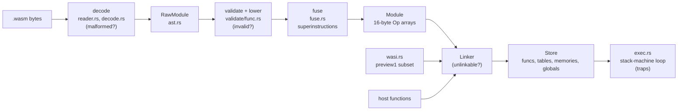

# wasmlet

A WebAssembly interpreter written from scratch in safe Rust: a binary
decoder, a validator that implements the specification's type-checking
algorithm, a compact 16-byte-per-op internal IR with a peephole
superinstruction pass, an interpreter with imports/exports, tables, memories
and traps, and a WASI preview1 subset that runs real `rustc`-compiled
programs.

It covers the **WebAssembly 2.0 core spec minus SIMD**: the MVP plus
multi-value, sign-extension, non-trapping float-to-int, bulk memory and
reference types. On the pinned official spec testsuite it passes
**27,437 of 27,437 executed directives across all 90 `.wast` files**
(581 directives skipped, all of them text-format `assert_malformed` cases,
which test a text parser wasmlet does not have).

```text
$ make spec
TOTAL: 27437/27437 directives passed (100.00%), 0 failed, 581 skipped; 90/90 files fully passing
```

**Who it is for:** people who want to read a complete, tested WebAssembly
engine that fits in one head (about 5,300 non-blank lines for the core library, `scripts/loc.sh`), and
embedders who need a small, dependency-light interpreter with fuel metering
and hard resource limits. It is not a production runtime; see
[Limitations](#limitations).

## Architecture



| layer | files | what it does |
|---|---|---|
| reader | `src/reader.rs` | bounds-checked cursor, LEB128 with the spec's length and unused-bit rules |
| decoder | `src/decode.rs`, `src/ast.rs` | every section of the 2.0 binary format, section order, data-count rules; errors carry byte offsets |
| op table | `src/ops.rs` | one macro table of all 136 immediate-free numeric ops, used to generate the decoder table, validator signatures, IR variants and the interpreter's dispatch |
| validator | `src/validate/` | module rules plus the spec appendix algorithm (operand stack with an `Unknown` type, control stack); **emits IR in the same pass** |
| IR | `src/ir.rs` | flat `Op` array, absolute branch targets with precomputed stack unwinding (`DropKeep`), untyped 64-bit slots; `Op` is 16 bytes (compile-time assert) |
| fusion | `src/fuse.rs` | peephole pass: compare-and-branch, `local += imm`, constant operands, paired `local.get` |
| runtime | `src/runtime/` | `Store` (object arenas), `Linker` (name resolution, fallback resolvers), instantiation in spec order, the interpreter loop, traps, fuel |
| WASI | `src/wasi.rs` | args, environ, `fd_read`/`fd_write` on stdio, clocks, `random_get`, `proc_exit`, `sched_yield`; anything else links as an `ENOSYS` stub |
| tools | `crates/wasmlet-cli`, `-spec`, `-fuzz`, `-bench` | CLI, `.wast` runner, fuzzer, benchmark |

More detail, including the algorithms and their complexity, is in
[docs/ARCHITECTURE.md](docs/ARCHITECTURE.md).

## Quickstart

```sh
make check   # fmt, clippy (-D warnings), rustdoc, all tests, coverage floor, fuzz smoke
make demo    # offline end-to-end demo (output below)
make spec    # per-file pass counts on the pinned spec testsuite
make fuzz    # long fuzz campaign
make bench   # wasmlet vs wasmi
```

Requirements: a stable Rust toolchain (MSRV 1.85) and, for `make check`,
`cargo-llvm-cov`. Nothing needs the network or Docker. The `wasm32-wasip1`
target is only needed to rebuild the committed guest binaries
(`make fixtures`).

The CLI:

```sh
cargo run --release -p wasmlet-cli -- run fixtures/wasm/hello-rust.wasm a b
cargo run --release -p wasmlet-cli -- run --invoke fib fixtures/wat/fib.wat 25
cargo run --release -p wasmlet-cli -- inspect --ir fixtures/wat/loop.wat
```

Embedding:

```rust
use wasmlet::{Linker, Module, Store, Value};

let module = Module::new(&wasm_bytes)?;
let mut store = Store::default();
let mut linker = Linker::new();
linker.func(&mut store, "env", "log", ty, |caller, args| { /* ... */ Ok(vec![]) });
let instance = linker.instantiate(&mut store, &module)?;
let add = store.instance_func(instance, "add")?;
let out = store.invoke(add, &[Value::I32(2), Value::I32(40)])?;
```

A compilable version of this example is the crate-level doctest in
`src/lib.rs`; `tests/embedding.rs` covers host functions that re-enter the
guest, registered instances, fallback resolvers and host-created objects.

## Demo

Output of `make demo` from a real run (ANSI bold removed; the unfused listing in step 6 trimmed):

```text
== 1. A rustc-compiled WASI program (std, args, env, collections)
$ wasmlet run --deterministic --env NAME=demo fixtures/wasm/hello-rust.wasm alpha beta
Hello from Rust compiled to wasm32-wasip1!
argv = ["fixtures/wasm/hello-rust.wasm", "alpha", "beta"]
NAME = demo
word counts: {"and": 1, "brown": 1, "dog": 1, "end": 1, "fox": 1, "jumps": 1, "lazy": 1, "over": 1, "quick": 1, "the": 3}
squares: [1, 4, 9, 16, 25, 36, 49, 64, 81, 100] (sum 385)
this line goes to stderr

== 2. Exit codes propagate from proc_exit
$ wasmlet run fixtures/wasm/hello-rust.wasm --fail; echo $?
exit status: 3

== 3. A rustc-compiled wc reading stdin
$ wasmlet run --stdin fixtures/text/poem.txt fixtures/wasm/wc-rust.wasm
8 lines, 46 words, 262 bytes
   12  the
    2  are
    2  bytes
    2  is
    2  module

== 4. Calling an export directly, with phase timings
$ wasmlet run --stats --invoke fib fixtures/wat/fib.wat 25
[stats] decode+validate+compile 0.013 ms, run 8.833 ms
75025:i32

== 5. Fuel metering stops a runaway computation with a clean trap
$ wasmlet run --fuel 100000 --invoke fib fixtures/wat/fib.wat 40
error: trap: all fuel consumed
exit status: 1

== 6. The compact IR, with and without superinstructions
$ wasmlet inspect --ir fixtures/wat/loop.wat   (then --no-fuse)
custom section `name`: 33 bytes
func 0 [i64] -> [i64]: 13 ops, max stack 4
  ; params=1 locals=2 results=1 max_stack=4 ops=13
     0: LocalGet2(1, 0)
     1: BrIfI64GeU @11
     2: LocalGet2(2, 1)
     3: LocalGet(1)
     4: I64Mul
     5: const 0x7
     6: I64RemU
     7: I64Add
     8: LocalSet(2)
     9: I64LocalAddImm { dst: 1, src: 1, imm: 1 }
    10: br @0
    11: LocalGet(2)
    12: Return { keep: 1 }
--- without superinstructions:
func 0 [i64] -> [i64]: 19 ops, max stack 4
     0: LocalGet(1)
     1: LocalGet(0)
     2: I64GeU
     3: br_if_nez @17
   ... (19 ops)

== 7. Malformed and invalid modules are rejected with a reason
error: malformed module at offset 0xa: length out of bounds
error: invalid module in function 0 at instruction 1: type mismatch

== 8. The pinned official spec testsuite (90 .wast files, baseline-checked)
$ wasmlet-spec --expect tests/spec/expected.tsv tests/spec/core | tail
utf8-invalid-encoding.wast        0/0      skipped  176
----
TOTAL: 27437/27437 directives passed (100.00%), 0 failed, 581 skipped; 90/90 files fully passing
rejection messages matching the reference interpreter: 2265/2279 (informational)
skipped:   581  text-format malformed module
```

## Correctness evidence

All numbers in this section come from the commands shown next to them.

### Official spec testsuite

`make spec` runs `wasmlet-spec` over the 90 `.wast` files of
[WebAssembly/spec](https://github.com/WebAssembly/spec) branch `wg-2.0`,
pinned at commit `fffc6e12` (`test/core/`, without the `simd/` directory),
vendored in `tests/spec/core` and checked by `scripts/verify-spec.sh`. The
`wast` crate parses the scripts and encodes their text modules to binary;
**everything after that — decoding, validation, linking, execution — is
wasmlet**. Per-file counts are printed by the command and committed in
[`tests/spec/expected.tsv`](tests/spec/expected.tsv), and the test
`spec_suite_matches_baseline` fails on any change in any file's
passed/failed/skipped triple.

| | count |
|---|---:|
| files | 90 (90 fully passing) |
| directives executed | 27,437 |
| passed | 27,437 |
| failed | 0 |
| skipped (text-format `assert_malformed`) | 581 |
| rejection messages identical to the reference interpreter (informational) | 2,265 / 2,279 |

What counts as a pass: `assert_return` compares results bit-exactly (with
`nan:canonical` / `nan:arithmetic` patterns), `assert_trap` requires a trap
whose message matches the expected text (prefix match either way, as the
reference interpreter appends details), `assert_exhaustion` requires a
call-stack-exhausted trap,
`assert_invalid` / binary `assert_malformed` / `assert_unlinkable` require
rejection at the right stage (decode vs validate vs link). The suite runs a
second time with superinstructions disabled (`make spec-plain`, and the test
`spec_suite_matches_baseline_without_superinstructions`) with identical
results.

### Fuzzing

`make fuzz` (seed 1, 2,000,000 decoder inputs, 50,000 generated modules):

```text
seed=1 corpus=3329 modules
decode       inputs=2000000 accepted=24073   rejected=1975927 calls=63562   compared=0      inconclusive=0     findings=0  (3.9s)
differential inputs=50000   accepted=50000   rejected=0       calls=38534   compared=40222  inconclusive=9778  findings=0  (27.3s)
no findings
```

* **Decoder campaign**: random bytes and structural mutations (bit flips,
  interesting bytes, LEB128 continuation bytes, insert/delete/duplicate/
  truncate, cross-splicing) of a 3,329-module seed corpus (the fixtures plus
  every module in the spec scripts). Every input checks: no panic in
  `Module::new`; **wasmlet's accept/reject verdict equals wasmparser's**
  (WebAssembly 2.0 minus SIMD); accepted modules without imports are
  instantiated and every export is run under a fuel budget; and the same
  module run without superinstructions behaves identically.
* **Differential campaign**: `wasm-smith` generates valid modules (2.0
  feature set, NaN canonicalisation, all items exported). Each export runs
  in wasmlet and in wasmi 2.0.0; results (bit-exact), trap categories and the
  final contents of every exported global, memory and table must agree.
  Cases where either engine hits a resource limit (fuel or call depth, whose
  accounting legitimately differs between engines) are counted as
  *inconclusive* — 9,778 of 50,000 above — never as passes.
* A fixed-seed slice of both campaigns (20,000 inputs and 600 modules) runs
  in `make check`.

The fuzzer runs on stable Rust and is deterministic per seed; failing inputs
are written to `fuzz-artifacts/` and can be replayed with
`wasmlet-fuzz --replay FILE...`.

### Tests and coverage

`make coverage` (part of `make check`) runs unit tests, integration tests
(`tests/embedding.rs`, `tests/wasi.rs`), CLI end-to-end tests and the full
spec suite under `cargo llvm-cov`, and fails below 90% line coverage of the
core library:

```text
$ make coverage
Filename      Regions    Missed Regions     Cover   Functions  Missed Functions  Executed       Lines      Missed Lines     Cover
...
TOTAL            6846               223    96.74%         359                 5    98.61%        3759                55    98.54%
```

`make coverage-report` prints the per-file table including the tool crates.

## Benchmarks

`make bench` on an Apple M1 Pro (shared with other jobs, load average about
5; medians of 7 runs; release builds; wasmi 2.0.0 with eager compilation).
Each workload's result is cross-checked between the engines, and the tool
exits non-zero on any disagreement.

| workload | n | wasmlet ms | wasmlet, no fusion ms | wasmi ms | wasmlet / wasmi | fusion speedup |
|---|---:|---:|---:|---:|---:|---:|
| fib-recursive (WAT, call-heavy) | 27 | 17.83 | 20.27 | 4.74 | 3.76x | 1.14x |
| loop-arith (WAT, i64 ALU + branch) | 5,000,000 | 93.47 | 128.23 | 18.26 | 5.12x | 1.37x |
| sieve (WAT, byte loads/stores) | 4,000,000 | 185.22 | 234.84 | 39.42 | 4.70x | 1.27x |
| matmul-f64 (WAT, f64 + calls) | 120 | 120.20 | 137.23 | 36.03 | 3.34x | 1.14x |
| sha256 (rustc `-Os`) | 20,000 blocks | 277.79 | 309.59 | 72.85 | 3.81x | 1.11x |
| mandelbrot (rustc `-Os`, f64) | 300 | 72.81 | 78.16 | 16.61 | 4.38x | 1.07x |

Geometric means: **wasmlet takes 4.14x wasmi's execution time**; the
superinstruction pass makes wasmlet 1.18x faster than without it.
Compile (decode + validate + lower) times were below 0.1 ms for every
module in both engines in this run (the tool prints them too).

Read these honestly: wasmi is a mature, register-based interpreter with
years of tuning; wasmlet is a straightforward stack machine in
`#![forbid(unsafe_code)]` Rust, so every operand-stack access is
bounds-checked. On this shared machine individual numbers move by roughly
10–20% between runs (fib-recursive is the noisiest).

## Design decisions

The full list, with the cost of each being wrong, is in
[DECISIONS.md](DECISIONS.md). The main ones:

* **Validate and lower in one pass.** The spec's validation algorithm already
  tracks the exact operand-stack height and control frames, which is all a
  compiler needs to resolve branch targets and how many values to keep and
  drop. Run-time control flow therefore has no control stack and no label
  lookups.
* **Untyped 64-bit slots.** Validation guarantees types, so the interpreter
  stores everything as `u64`; i32 reads truncate, which lets `f32.load` and
  `i32.load` share one op and keeps every `Op` at 16 bytes.
* **No native recursion for guest calls.** Wasm-to-wasm calls push an
  explicit frame, so deep recursion ends in a clean
  `call stack exhausted` trap governed by `Config::max_call_depth`, never in
  a host stack overflow.
* **Safe Rust only** (`unsafe_code = "forbid"`), accepting the bounds-check
  cost in exchange for memory safety that does not depend on the validator
  being bug-free.
* **Superinstructions as a separate, switchable pass** so their benefit can
  be measured (`--no-fuse`, `CompileOptions`) and their correctness checked
  differentially (spec suite twice, fuzz oracle comparing fused and unfused
  runs including fuel use).

## Limitations

* **No SIMD**, and no post-2.0 proposals (threads, tail calls, exceptions,
  GC, memory64, multi-memory, extended-const). Modules using them are
  rejected at decode or validation.
* **No text format.** wasmlet reads binary modules only; the CLI converts
  `.wat` with the `wat` crate, and the 581 text-format `assert_malformed`
  directives in the testsuite are skipped for that reason.
* **WASI is a small preview1 subset**: stdio, args, environment, clocks,
  random, `proc_exit`, `sched_yield`. There is no filesystem (no preopens),
  no sockets, no `poll_oneoff`; those imports link as stubs returning
  `ENOSYS`.
* **Speed**: about 4x slower than wasmi on the benchmarks above; no JIT, no
  register allocation, no lazy compilation.
* **Rejection messages** match the reference interpreter's text in 2,265 of
  2,279 checked cases; the remaining 14 are reported with different wording
  (the pass criterion is the rejection stage, not the wording).
* **Resource limits are per store and coarse**: call depth, value-stack
  slots, memory pages and table elements. Fuel counts branches and calls,
  not instructions, so straight-line code between branches is not metered.
* **The store never frees.** Objects live until the `Store` is dropped,
  including those allocated by a failed instantiation; a long-lived store
  that instantiates many modules grows without bound.
* **Fuzzing is in-tree and stable-toolchain**, not coverage-guided
  (libFuzzer/AFL); it found no failures in the campaigns above, which is
  evidence, not proof. The differential campaign's oracle (wasmi) could share
  a bug with wasmlet.
* The `.github/workflows/ci.yml` pipeline mirrors `make check` but has not
  run yet: the repository has not been pushed.

## Roadmap

* More superinstructions driven by dynamic op-pair profiles (loads/stores
  with a local base address, compare against an immediate).
* A register-based IR to cut operand-stack traffic, measured against the
  current stack IR with the same benchmark harness.
* More of WASI preview1 (preopened directories over an in-memory or
  sandboxed filesystem, `poll_oneoff`).
* SIMD (`v128`) and the post-2.0 proposals, each gated on its spec tests.
* A coverage-guided `cargo fuzz` target reusing the same oracles.

## License

MIT (see [LICENSE](LICENSE)). The vendored spec testsuite in `tests/spec/`
is Apache-2.0 (see [tests/spec/LICENSE](tests/spec/LICENSE) and
[DATA.md](DATA.md)).
