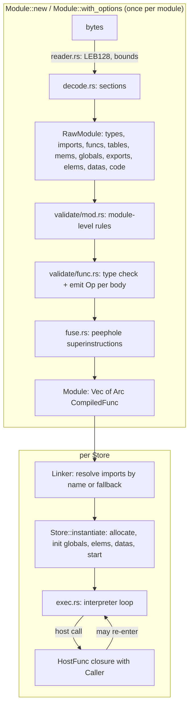

# wasmlet architecture

This document follows a module from bytes to execution and states the
algorithms and their costs. `n` is the size of the input in bytes, `k` the
number of instructions in a function body, `d` the maximum control nesting
depth.



## 1. Decoding (`src/reader.rs`, `src/decode.rs`)

* **Reader.** A cursor over `&[u8]` with a base offset, so nested readers
  (one per section, one per function body) report module-absolute offsets.
  Every read returns `Result`; there is no indexing that can panic. LEB128
  decoding enforces the spec's maximum length (`ceil(N/7)` bytes) and that the
  unused bits of the final byte are a sign- or zero-extension ("integer
  representation too long" / "integer too large").
* **Counts are checked against the bytes left.** Before allocating a vector
  of `c` items whose encoding is at least `m` bytes each, the reader checks
  `c * m <= remaining`, so a 5-byte count of 2^32 cannot make the decoder
  allocate gigabytes. The local-declaration total is capped separately
  ("too many locals").
* **Sections** must appear in the order the spec defines (custom sections
  anywhere), each at most once; each section must consume exactly its
  declared size. The function and code sections must agree in length, and
  the data-count section, when present, must match the data section and is
  required by `memory.init`/`data.drop`.
* **Instructions** are decoded into a flat `Vec<Instr>` per body, tracking
  only nesting depth to find the closing `end`; no recursion is used, so
  deeply nested blocks cannot overflow the host stack.
* Immediate-free numeric instructions come from a single table
  (`for_each_numop!` in `src/ops.rs`, 136 entries with opcode and type
  signature) that also generates the validator's signatures and the IR
  variants, so the three can never disagree.

Cost: O(n) time; memory proportional to the decoded module.

## 2. Validation and lowering (`src/validate/`)

Module-level validation checks index spaces, limits (`min <= max`, memory
at most 65,536 pages), constant expressions (only `*.const`, `ref.null`,
`ref.func`, and `global.get` of imported immutable globals), unique export
names, the start function's type, element/data segment modes, and which
functions may be referenced by `ref.func` (those declared in elements,
exports or globals).

Function bodies are checked with the algorithm in the specification's
validation appendix: an operand stack of `Option<ValType>` (`None` is the
polymorphic *Unknown* produced after `unreachable`/`br`/`return`) and a
control stack of frames `{kind, params, results, height, unreachable}`.

**The same pass emits IR.** Because the checker knows the exact operand-stack
height at every instruction, branches can be resolved statically:

* `block`/`loop` emit nothing. A branch to a `loop` gets the loop's start
  index immediately; a branch to a `block`/`if` records a fixup that is
  patched when the frame's `end` is reached.
* `if` emits `BrIfEqz` to the `else` (or `end`); `else` emits a `Br` to the
  `end` and patches the `if`.
* Every branch carries a `DropKeep {drop, keep}`: `keep` is the label's
  arity and `drop` the number of operand slots between the label's base
  height and those kept values. At run time the interpreter moves the top
  `keep` slots down by `drop` — there is no control stack.
* `br_table` emits `BrTable {len}` followed by `len + 1` `BrTarget` entries
  (each with its own target and `DropKeep`), so the jump is an index into
  the code array.
* `br` to the function frame and `return` become `Return {keep}`.
* The maximum operand-stack height is recorded per function so a frame's
  stack space is reserved once at call time.

Cost: O(k) time per function body (each instruction pushes/pops a bounded
number of types, except multi-value block signatures which cost their
arity), O(k + d) space.

## 3. The IR (`src/ir.rs`)

```text
enum Op            // 16 bytes, asserted at compile time
  Br { target, dk } | BrIfNez { target, dk } | BrIfEqz { target } | BrTable { len } | BrTarget { target, dk }
  Return { keep } | Call(func) | CallIndirect { type_idx, table }
  LocalGet(i) | LocalSet(i) | LocalTee(i) | GlobalGet(i) | GlobalSet(i)
  Load8S(off) .. Load64(off) | Store8(off) .. Store64(off)   // by width, not type
  Const(u64) | 136 numeric ops | table/memory/bulk ops | ref ops
  superinstructions (section 4)
```

* **Values are untyped 64-bit slots.** Validation already proved the types,
  so `f32.load` and `i32.load` are the same `Load32U`, and constants of every
  type are one `Const(u64)`. An i32 may carry garbage in its upper 32 bits;
  every i32 consumer truncates, so producers never need to clear them.
  References are encoded as `store_address + 1`, with 0 as null.
* **Frame layout** on the single value stack:

  ```text
  fp                fp+params         fp+params+locals
  | params ...      | locals (zeroed) | operand stack ... | <- sp
  ```

  Arguments are already on the caller's operand stack, so a call just moves
  `fp` down to the first argument; no copying.

## 4. Superinstructions (`src/fuse.rs`)

Dispatch dominates a stack interpreter's cost, so a linear peephole pass
replaces frequent short sequences with single ops:

| sequence | fused op |
|---|---|
| `local.get s; const c; i32.add/sub; local.set d` | `I32LocalAddImm {dst, src, imm}` (and the i64 form when `c` fits in i32) |
| `<i32/i64 relational op>; br_if L` with nothing to unwind | `BrIf<cmp> {target}` |
| `<i32/i64 relational op>; if` | `BrIf<inverse cmp> {target}` (integer comparisons invert exactly) |
| `i32.eqz`/`i64.eqz` before `br_if`/`if` | `BrIfEqz`/`BrIfNez`/`BrIfI64Eqz`/`BrIfI64Nez` |
| `const c; add/sub/mul/and/shl/shr_s/shr_u` | `<op>Imm(c)`; `sub` becomes `add` of `-c`, shift counts pre-masked |
| `local.get a; local.get b` | `LocalGet2(a, b)` |

Correctness rules:

1. A window is fused only if no op inside it except the first is a branch
   target, so control never enters the middle of a fused op.
2. Branch targets are renumbered through an old-index to new-index map built
   during the same scan.
3. `BrTable` and its `BrTarget` entries are never part of a window, so they
   stay contiguous.
4. Fuel is unchanged: a fused op that contains a branch burns exactly the one
   unit that branch would have.

The pass is O(k) time and O(k) space. It is on by default and can be turned
off with `CompileOptions { superinstructions: false }` or `--no-fuse`. The
spec suite runs in both modes, and both fuzz campaigns compare every
accepted module's fused and unfused behaviour, including fuel consumed. On
the benchmark set the pass is worth 1.18x (geometric mean; see README).

## 5. Runtime (`src/runtime/`)

* **Store** owns everything as arenas indexed by `u32`: function instances
  (wasm code `Arc<CompiledFunc>` plus owning instance, or a host closure),
  tables (`Vec<u64>` of reference slots), memories (`Vec<u8>`), globals,
  element and data segments, and instances. Handles (`Func`, `Table`,
  `Memory`, `Global`, `Instance`) are plain indices, so they are `Copy` and
  cheap. Nothing is freed before the store is dropped.
* **Function types are interned** per store: equal signatures share one id,
  so the `call_indirect` signature check is one integer compare, and it is
  correct across modules.
* **Linker** resolves `(module, name)` pairs from definitions, registered
  instances (the spec tests' `register`), and an optional fallback closure
  (WASI uses it to stub unimplemented imports). Import types are checked
  with the spec's matching rules (limits subtyping, exact function and
  global types).
* **Instantiation** follows the spec order: check imports, allocate
  functions, tables, memories and globals (evaluating constant expressions),
  build exports, then run active element segments, active data segments and
  the start function. A trap during segment initialisation is returned, and
  effects already applied to imported tables and memories persist, as the
  spec requires.
* **The interpreter** (`exec.rs`) is one `loop { match code[pc] { ... } }`
  over the IR. Wasm-to-wasm calls push a `Frame {func, pc, fp, instance}` on
  a `Vec` instead of recursing, so guest recursion depth is bounded by
  `Config::max_call_depth` and ends in a clean `call stack exhausted` trap;
  the value stack grows on demand up to `Config::max_value_stack`. Host
  calls receive a `Caller` with `&mut Store`, so a host function may invoke
  guest functions re-entrantly (each invocation borrows the store's value
  stack afresh).
* **Memory accesses** compute `addr as u32 + offset` in 64-bit arithmetic and
  compare with the memory length, so no access can wrap. Bulk operations
  check the whole range before copying, matching the 2.0 semantics where an
  out-of-bounds `memory.copy`/`fill`/`init` traps without partial writes.
* **Traps** are an enum whose `Display` matches the spec testsuite's
  messages. Integer division, remainder and float-to-int truncation follow
  the spec's trapping rules; NaN results of float arithmetic are whatever
  the host produces, which the spec permits (the tests' `nan:arithmetic`
  patterns accept them).
* **Fuel** (`Config::fuel`) charges one unit per executed branch (`br`,
  `br_if`, `br_table`, `if`) and call. Every loop iteration contains a
  branch, so any non-terminating guest runs out.

## 6. WASI (`src/wasi.rs`)

`add_to_linker` defines, in module `wasi_snapshot_preview1`:
`args_get`, `args_sizes_get`, `environ_get`, `environ_sizes_get`,
`fd_write` (fds 1, 2), `fd_read` (fd 0), `fd_close`, `fd_seek` (stdio is not
seekable: `ESPIPE`), `fd_fdstat_get`, `fd_prestat_get` and
`fd_prestat_dir_name` (no preopens: `EBADF`), `clock_time_get`,
`clock_res_get`, `random_get`, `sched_yield` and `proc_exit` (a
`Trap::Exit(code)` that `run_command` turns into an exit status). Every
guest pointer is range-checked against the caller's memory and reported as
`EFAULT`. Any other `wasi_snapshot_preview1` function import is linked as a
stub returning `ENOSYS`, so binaries that merely import more of WASI still
run. Output can be captured in the `WasiCtx` (tests) or forwarded to the
host's stdout/stderr (CLI); a deterministic mode fixes the clock and the
random stream.

## 7. Testing architecture

| layer | what it checks | where |
|---|---|---|
| unit tests | reader, decoder error paths, op table, IR display, fusion patterns, numeric semantics, traps, values | `#[cfg(test)]` in `src/` |
| spec suite | 27,437 directives in 90 official `.wast` files, per-file counts pinned in `tests/spec/expected.tsv`, run with and without fusion | `crates/wasmlet-spec` |
| integration | embedding API, linking, host re-entry, limits, WASI per call and with `rustc` guests | `tests/` |
| end to end | the `wasmlet` and `wasmlet-spec` binaries | `crates/*/tests/cli.rs` |
| fuzz | decoder panics, verdict vs wasmparser, execution vs wasmi, fused vs unfused | `crates/wasmlet-fuzz` |
| benchmark | speed vs wasmi, doubling as a result cross-check | `crates/wasmlet-bench` |

## 8. Complexity summary

| stage | time | space |
|---|---|---|
| decode | O(n) | O(n) |
| validate + lower | O(k) per body | O(k + d) |
| fuse | O(k) per body | O(k) |
| instantiate | O(size of tables, memories, segments) | same |
| interpret | O(1) per op, except bulk memory/table ops O(length) and `memory.grow` O(new size) | value stack O(sum of frame sizes) |
